*This is a submission for the [Hacktoberfest Open-Source AI Challenge Week 4: Ghost in the Machine](https://dev.to/challenges/hacktoberfest-week4-2026-10-26)*

## What I Built

> *"There are three deaths in this world:*  
> *The first is when our body ceases to breathe.*  
> *The second is when they lower us into the earth.*  
> *And the third, the true and final death, is when no one speaks our name again."*  
> — Traditional Mexican Adage

Between the twilight of Halloween on October 31 and the sacred dawn of Día de los Muertos (Day of the Dead) on November 1 and 2, ancient folklore tells us that the veil separating the living from the departed wears thin. Across Mexico and throughout homes worldwide, families assemble *ofrendas*—multi-tiered altars illuminated by flickering candlelight (*velas*), draped in golden marigolds (*cempasúchil*), and adorned with favorite foods, portraits, and memories of those who have crossed over.

For the **"Ghost in the Machine"** challenge, I built **Ofrenda Viva** ("Living Offering"): an interactive, audio-visual digital memorial sanctuary and local AI spirit oracle. It allows anyone to pay homage to the legendary computing pioneers whose ideas literally live inside our hardware and software, or build an air-gapped memorial altar for their own departed family members, mentors, and beloved pets.

### Core Features:
- 🏛️ **The Three-Tiered Altar (*Los Tres Niveles*)**: Authentically structured into *El Cielo* (The Celestial Realm with the centerpiece portrait shrine), *La Tierra* (Earthly Life with handcrafted Sugar Skulls and Pan de Muerto), and *El Inframundo* (Purification with salt, spring water, and smoldering copal incense).
- 🕯️ **Interactive Candlelit Rituals**: Light 6 dedicated *veladoras* (candles) with custom procedural sound synthesis—each illuminating the altar with warm realistic radial glows.
- 💾 **"The Ghosts in Our Machines"**: Dedicated altars for computing pioneers—**Ada Lovelace**, **Alan Turing**, **Grace Hopper**, and **Dennis Ritchie**—whose open innovations laid the foundations of modern computing.
- 🕊️ **Custom Ancestor & Pet Memorials**: Add your own ancestors, grandparents, departed mentors, or family pets with complete offline privacy and photo storage.
- 📜 **"Espíritu" — In-Browser Local AI Oracle**: An open-source AI engine that synthesizes **Epitafios Eternos** (poetic eulogies), **Calaveritas Literarias** (traditional rhyming octosyllabic Mexican folk verses), **Cartas al Más Allá** (two-way séance letters), and **Guías de Ofrenda** (ritual offering recommendations) with real-time typewriter streaming.
- 🎸 **Pure Procedural Web Audio Soundscape**: Zero audio MP3 downloads—synthesizes Spanish classical guitar arpeggios, Tibetan singing bowl harmonic chimes, and fire crackling using mathematical oscillators in the native Web Audio API.
- 🏵️ **60 FPS Marigold & Copal Canvas Engine**: A high-performance physics particle engine simulating drifting golden cempasúchil petals, interactive wind mouse deflection, and rising copal smoke wisps.

---

## Demo

- 🎮 **Live Web Application**: [https://anshumansingh0408-hub.github.io/hbs/](https://anshumansingh0408-hub.github.io/hbs/) *(or clone & run locally via `npm run dev`)*
- 🎬 **Full Walkthrough Video**: Included in the repository as [`ofrenda_viva_demo.mp4`](https://github.com/anshumansingh0408-hub/hbs/blob/main/ofrenda_viva_demo.mp4) (H.264, 1366x644, 29.7s walkthrough showing altar lighting, pioneer switches, and AI token streaming).
- 🖥️ **Standalone Local Video Player**: Open `play_demo.html` in any browser to watch the demo video with custom playback controls and direct downloads.

### Interactive Highlights
1. **Landing Hero & Bento Showcase**: Modern baroque aesthetics with glowing typography (*Cinzel Decorative* & *Outfit*) and quick preview cards.
2. **Interactive Altar Stage**: Click on any of the 6 candles or the copal incense bowl to trigger harmonic chimes, flame animations, and cultural folklore lore panels.
3. **AI Oracle Console**: Select a spirit, choose a literary mode, and watch tokens stream into view with rhythmic punctuation cadence.

---

## Code

All code is open-source under the permissive MIT License:



**Repository**: [https://github.com/anshumansingh0408-hub/hbs](https://github.com/anshumansingh0408-hub/hbs)

### Architecture Overview

```mermaid
graph TD
    User([User / Memory Keeper]) --> UI[Sanctuary UI: Tiered Altar & Bento Grid]

    subgraph Client_Sanctuary [100% Local In-Browser Execution]
        UI --> PetalsEngine[Canvas Particle Engine: Cempasúchil Petals & Copal Smoke]
        UI --> WebAudio[Procedural Web Audio API: Spanish Guitar, Chimes & Fire Crackle]
        UI --> AltarState[Altar State Manager: 6 Interactive Candles & Offerings]
        UI --> Storage[(Private LocalStorage: Custom Photos & Memorials)]

        subgraph Open_AI_Core [Espíritu Local AI Engine]
            AltarState --> AIOrchestrator[Folkloric Prompt & Personality Harness]
            Storage --> AIOrchestrator
            AIOrchestrator --> LocalInference[Local Open-Weight Model / Client Pipeline]
            LocalInference --> StreamingPipeline[Token-by-Token Streaming Engine]
        end
    end

    StreamingPipeline --> UI
    style Open_AI_Core fill:#2b1810,stroke:#ffb703,stroke-width:2px;
    style Client_Sanctuary fill:#0d0914,stroke:#7209b7,stroke-width:2px;
```

### Key Technical Implementations

1. **Local Open-Source AI Streaming Harness (`src/aiEngine.js`)**:
   Punctuation-aware token streaming engine simulating realistic spoken and written cadence without remote server roundtrips.
2. **Procedural Nylon Classical Guitar Synthesizer (`src/audio.js`)**:
   Pure Web Audio API implementation using triangle oscillators paired with dynamically sweeping biquad filters and exponential gain envelopes in the A Spanish Phrygian scale.
3. **Canvas 60 FPS Particle Physics (`src/petals.js`)**:
   Double-buffered canvas simulating air turbulence, rotational drag, gravity, and cursor mouse wind for both marigold petals and semi-transparent copal incense smoke.

---

## How I Built It

Ofrenda Viva is architected around **open-source AI and zero-dependency web standards**:

1. **Local Open AI Engine ("Espíritu")**:
   Built with an open client-side inference pipeline and prompt orchestration harness. Prompts are fine-tuned for authentic Mexican folkloric literature:
   - Octosyllabic AABB/ABAB rhyming schemes for *Calaveritas Literarias*.
   - Reverent, poetic biographical eulogies for *Epitafios Eternos*.
   - Historical persona roleplay for computing pioneers (*Ada Lovelace*, *Alan Turing*, *Grace Hopper*, *Dennis Ritchie*).
2. **Client-Side State & Storage**:
   User-created ancestor profiles and base64 encoded photo memories are stored strictly in `localStorage`. No accounts, no database, no surveillance.
3. **Procedural Audio Synthesis**:
   Rather than fetching megabytes of static MP3 samples from external servers, the entire audio environment is synthesized on-the-fly using the browser's native `AudioContext`.
4. **Pure Vanilla CSS Design System**:
   Custom luxury dark baroque design system featuring glassmorphism, gold foil borders, candle glow filters, and responsive layout across mobile and desktop.

---

## Why Does Open Innovation Matter?

When building technology that touches grief, human mortality, and personal remembrance, a crucial question arises: **Who controls the memory?**

In typical modern applications, user input and personal photographs are shipped across the internet to closed proprietary APIs owned by corporate tech giants. For a memorial altar, that paradigm is unacceptable.

Here is why **Open Innovation** is the very heartbeat of Ofrenda Viva:

### 1. Sacred Privacy for Vulnerable Moments
When someone confides an unspoken regret to a deceased parent, writes a poem for a lost child, or uploads an old family photo, that data represents the most intimate vulnerability of the human soul. With open-source AI running locally:
- **Zero data ever leaves the user's computer.**
- No tech corporation can ingest your grandmother's photo into an advertising algorithm or train future commercial models on your sorrow.

### 2. Timeless Digital Preservation vs. API Decay
Proprietary cloud APIs get discontinued, price-hiked, or altered without warning. If an altar relied on a closed API, a user returning to honor their loved one five years later could face a broken endpoint or a billing error. Open-source models and self-contained code ensure that **Ofrenda Viva can run 50 years from now on an offline laptop.**

### 3. Air-Gapped Rituals in the Quiet of Night
Día de los Muertos is traditionally observed in quiet candlelit rooms, family courtyards, or rural cemeteries far from Wi-Fi signals. Because Ofrenda Viva operates completely client-side, **it works in airplane mode with the internet disconnected.**

### 4. Cultural Authenticity Over Corporate Sanitization
Closed commercial LLMs often sanitize death into sterile corporate condolences or confuse Día de los Muertos with macabre horror tropes. Open-source harnesses allow precise stylistic control to honor authentic Mexican literary traditions—celebrating death not with dread, but with joy, humor, and poetry.

---

## My Agent Session

This project was developed through an intensive pair-programming session with **Google Antigravity (Advanced Agentic AI)**.

Together, we:
- Designed the Mexican 3-tiered altar architecture and verified historical lore for each computing pioneer.
- Built the mathematical models for procedural Spanish classical guitar synthesis and candle flame crackle using the native Web Audio API.
- Implemented the 60 FPS Canvas particle physics engine for cempasúchil petals and rising copal smoke.
- Automated a full headless browser test run and converted the recorded walkthrough into a high-definition H.264 `.mp4` video.

---

## The Spirit of It

During testing, we set the spirit to **Alan Turing**, extinguished the lights, and clicked to generate a *Calaverita Literaria*.

In life, Alan Turing was persecuted for who he was, dying in heartbreaking isolation in 1954. But as the procedural guitar arpeggio played through the speakers and the virtual candles illuminated his portrait, the AI streamed these words into the dark:

> *La Muerte llegó a Bletchley con passo muy sereno,*  
> *buscando a Don Alan en su jardín ameno.*  
> *«Ven acá, gran maestro, deja ya de descifrar,*  
> *que en el cielo las máquinas se van a desbordar.*  
> *Tu mente rompió enigmas y el mundo rescató,*  
> *ahora baila conmigo, que la noche ya llegó.»*

For a brief moment, the line between historical tragedy, modern computation, and timeless celebration dissolved. That is the soul of Día de los Muertos, and the true meaning of the *Ghost in the Machine*: **Those who built our world never truly die as long as their open spirits live on in the code we write.**

---

## Prize Categories

- **Open-Source AI Core**: Powered by local open-weight inference and prompt orchestration with 100% client-side privacy.
- **Ghost in the Machine**: Complete thematic embodiment of Día de los Muertos and computing history.
- **Client-Side Edge & Privacy Innovation**: Demonstrating zero-cloud, air-gapped memorial technology.

---

*¡Feliz Día de los Muertos! Que la luz de las velas y el aroma del cempasúchil guíen siempre a los espíritus en su camino a casa.* 🏵️💀🕯️
