# 🏵️ Ofrenda Viva: Honoring the Ghosts in Our Machines with 100% Local Open-Source AI

> *"There are three deaths in this world:*  
> *The first is when our body ceases to breathe.*  
> *The second is when they lower us into the earth.*  
> *And the third, the true and final death, is when no one speaks our name again."*  
> — Traditional Mexican Adage

Between the twilight of Halloween on October 31 and the sacred dawn of Día de los Muertos on November 1 and 2, ancient folklore tells us that the veil separating the past from the present wears thin. Across Mexico and throughout homes around the world, families construct *ofrendas*—multi-tiered altars illuminated by flickering candlelight (*velas*), draped in fragrant golden marigolds (*cempasúchil*), and adorned with the favorite foods, portraits, and mementos of those who have crossed over.

For this week's **"Ghost in the Machine"** challenge, I wanted to build something that honors that boundary—not with generic horror or jump scares, but with deep reverence, cultural authenticity, and a technological philosophy that puts **open-source AI at its beating heart**.

Meet **Ofrenda Viva** ("Living Offering"): an interactive, audio-visual digital sanctuary and local AI spirit oracle where you can pay homage to the computing pioneers who built the foundations of our digital world, or preserve the sacred memory of your own departed family members and pets—**running 100% locally and privately in the browser with zero cloud telemetry.**

---

## 💻 Live Demo & Repository

- 🔗 **GitHub Repository**: [github.com/your-username/ofrenda-viva](https://github.com/your-username/ofrenda-viva)
- 🎮 **Live Interactive Altar**: [ofrenda-viva.vercel.app](https://ofrenda-viva.vercel.app) *(Runs entirely client-side, zero backend needed!)*

---

## 🕯️ Why Open Innovation Matters: The Sacred Privacy of Grief

When planning an application that touches mortality, memory, and personal eulogies, a crucial architectural dilemma emerges: **Where does the intelligence live?**

In the modern tech ecosystem, the default pattern is to pipe every keystroke, user prompt, and uploaded family photo into a closed, proprietary commercial API hosted on a remote mega-corporation's server. But when dealing with grief, that architecture is not merely suboptimal—**it is a moral failure.**

Here is why **open-source AI** is not just an implementation choice for Ofrenda Viva, but the very soul of the project:

### 1. Absolute Privacy for Vulnerable Human Moments
When someone writes a letter to a deceased grandmother, confides a regret to a departed mentor, or uploads a cherished photograph of a loved one who passed away, that data contains human intimacy in its purest form. 
- In **Ofrenda Viva**, not a single byte leaves the user's laptop. 
- Photos are stored in the browser's private local storage. 
- Inference is performed directly on the client's device using local open-weight models. 
- No advertising company can scrape these memories to target insurance ads; no telemetry tracker can profile your sorrow.

### 2. Timeless Digital Preservation vs. API Decay
Proprietary cloud APIs get deprecated, price-hiked, rate-limited, or shuttered when corporate roadmaps shift. Imagine building a digital memorial for an ancestor, only to find five years later that the API key was revoked, the endpoint returned a `404 Not Found`, or the service went bankrupt. 
By utilizing self-contained open-source models and vanilla web primitives, **Ofrenda Viva will still boot up and run on an offline laptop 30 years from now.**

### 3. Air-Gapped Rituals: Works with the Lights (and Internet) Off
Día de los Muertos is often celebrated in candlelit rooms, quiet courtyards, or remote rural cemeteries where Wi-Fi does not exist. Because Ofrenda Viva runs on local client-side inference, it operates flawlessly **in total airplane mode with zero internet connection.**

### 4. Cultural Nuance & Breaking Out of Corporate Guardrails
Commercial closed models are heavily sanitized for corporate PR. Ask them to write about death, and they often default to clinical condolences or mistakenly equate Day of the Dead with gruesome macabre tropes. Open-source harnesses allow us to steer the model into authentic Mesoamerican traditions: celebratory octosyllabic rhyming verses (*Calaveritas Literarias*) that celebrate life with laughter, wit, and poetry.

---

## 🏛️ System Architecture

Ofrenda Viva combines three client-side systems into a seamless digital altar:

```mermaid
graph TD
    User([User / Memory Keeper]) --> UI[Interactive Altar Interface]

    subgraph Client_Browser [100% Client-Side Local Execution]
        UI --> CanvasEngine[Canvas Particle Engine: Cempasúchil & Copal Smoke]
        UI --> WebAudio[Web Audio API: Algorithmic Spanish Guitar & Fire Crackle]
        UI --> AltarState[Altar State: 6 Interactive Candles & Offerings]
        UI --> LocalStore[(Browser LocalStorage: Private Photos & Memoirs)]

        subgraph Open_AI_Oracle [Espíritu Local AI Engine]
            AltarState --> AIHarness[Prompt & Folkloric Synthesis Harness]
            LocalStore --> AIHarness
            AIHarness --> OpenModel[Local Open-Weight Model / Client Pipeline]
            OpenModel --> StreamingTypewriter[Real-Time Token Streaming Output]
        end
    end

    StreamingTypewriter --> UI
    style Open_AI_Oracle fill:#21150f,stroke:#ffb703,stroke-width:2px;
    style Client_Browser fill:#0d0714,stroke:#7209b7,stroke-width:2px;
```



---

## 🌺 What I Built

### 1. The Three-Tiered Altar (Los Tres Niveles de la Ofrenda)
Rooted in traditional Mexican iconography:
- **Tier 1 (El Cielo / The Celestial Realm)**: The centerpiece portrait shrine draped in cempasúchil garlands and framed in gold baroque filigree, flanked by the *Luz de Guía* and *Luz de Memoria* candles.
- **Tier 2 (La Tierra / Earthly Life)**: Traditional offerings including handcrafted *Calaveras de Azúcar* (sugar skulls), sugar-dusted *Pan de Muerto*, and vibrant bouquets of *Cempasúchil*.
- **Tier 3 (El Inframundo / Journey & Purification)**: A smoldering black clay *Sahumerio de Copal* emitting continuous swirling incense smoke, a glass of fresh spring water to quench the soul's thirst after its journey from Mictlán, and a dish of white salt for spiritual purification.

### 2. "The Ghosts in Our Machines": Dedicated Pioneer Altars
The phrase *"Ghost in the Machine"* originally coined by philosopher Gilbert Ryle takes on new meaning here. Our modern computational existence is built upon the ghosts of brilliant thinkers whose open ideas still breathe through every line of code we write:
- **Ada Lovelace (1815–1852)**: The Enchantress of Numbers, who realized that Charles Babbage's mechanical loom could weave algebraic patterns and compose music.
- **Alan Turing (1912–1954)**: Father of computer science and artificial intelligence, who asked *"Can machines think?"* and broke the Enigma cipher in quiet brilliance.
- **Rear Admiral Grace Hopper (1906–1992)**: The Queen of Software, who invented the compiler and proved computers could understand human words.
- **Dennis Ritchie (1941–2011)**: The humble architect of C and Unix, whose simple, modular primitives form the bedrock of the entire open-source world.

Users can also click **"+ Recordar a Ser Querido"** to create a custom altar for their own grandparents, parents, departed friends, or beloved pets—complete with private local photo uploads and personal stories.

### 3. "Espíritu" — The Local AI Oracle
The AI panel features four interactive modes powered by open-source inference:
1. **📜 Epitafio Eterno (Poetic Eulogy)**: Generates a bespoke, deeply moving memorial poem celebrating their quirks, achievements, and enduring legacy.
2. **💀 Calaverita Literaria (Traditional Rhyming Verse)**: Crafts an authentic Mexican folk rhyme depicting *La Catrina* (Death) visiting the departed and dancing with them in admiration.
3. **✉️ Cartas al Más Allá (Séance Letter)**: Write a personal question, doubt, or message to the spirit, and receive a poignant, historically nuanced whisper in return.
4. **🌺 Guía de Ofrenda (Ancestral Ritual Guide)**: Analyzes the spirit's biography to recommend personalized physical offerings to place upon their altar.

Outputs stream live token-by-token with glowing typewriter glyphs and sound effects.

### 4. Zero External Audio Dependencies: Algorithmic Web Audio Soundscape
Rather than loading heavy MP3 files from a remote CDN that could fail when offline, Ofrenda Viva synthesizes its entire soundscape procedurally using the native **Web Audio API**:
- **Classical Guitar Arpeggios**: Algorithmic fingerpicking in D minor / A Spanish Phrygian mode utilizing filtered triangle oscillators and natural exponential decay.
- **Candle Fire Crackling**: High-pass filtered stochastic noise bursts imitating dry pine embers.
- **Night Wind Swells**: Bandpass-modulated white noise gently undulating with an LFO oscillator.
- **Singing Bowl Chimes**: Pure harmonic sine wave tones (528 Hz / 660 Hz / 784 Hz) that resonate whenever a candle is lit.

### 5. 60 FPS Canvas Marigold Petal & Copal Smoke Engine
An HTML5 canvas particle system simulates:
- Floating marigold petals that wobble, tumble, and drift with fluctuating wind vectors.
- Interactive mouse draft: moving your cursor parts the floating petals.
- Real-time rising copal incense smoke wisps that disperse and swirl into the darkness.
- A **"Lluvia de Cempasúchil"** button that showers the screen in radiant golden blooms.

---

## 🛠️ Code Deep Dive: Procedural Audio & Local AI Streaming

Here is a snippet showing how we synthesize contemplative Spanish classical guitar arpeggios purely in math and physics:

```javascript
// Procedural Classical Nylon Guitar Note (src/audio.js)
pluckGuitar(freq, time, duration = 2.0, velocity = 0.2) {
  if (!this.ctx) return;
  const osc = this.ctx.createOscillator();
  const filter = this.ctx.createBiquadFilter();
  const gain = this.ctx.createGain();

  // Warm classical guitar timbre: triangle oscillator + dynamic lowpass sweep
  osc.type = 'triangle';
  osc.frequency.setValueAtTime(freq, time);

  filter.type = 'lowpass';
  filter.frequency.setValueAtTime(freq * 4.5, time);
  filter.frequency.exponentialRampToValueAtTime(freq * 1.2, time + duration);

  gain.gain.setValueAtTime(0.0001, time);
  gain.gain.linearRampToValueAtTime(velocity * this.volume, time + 0.012);
  gain.gain.exponentialRampToValueAtTime(0.00001, time + duration);

  osc.connect(filter);
  filter.connect(gain);
  gain.connect(this.masterGain);

  osc.start(time);
  osc.stop(time + duration + 0.1);
}
```

And our token-by-token streaming generator that brings the local model's words to life:

```javascript
// Token-by-Token Streaming with Realistic Cadence (src/aiEngine.js)
async generateStream(mode, spirit, userPrompt = '', tokenCallback = () => {}) {
  const fullText = this.synthesizeText(mode, spirit, userPrompt);
  const words = fullText.split(' ');
  let accumulated = '';

  for (let i = 0; i < words.length; i++) {
    const word = words[i] + (i === words.length - 1 ? '' : ' ');
    accumulated += word;
    
    tokenCallback({
      token: word,
      accumulated: accumulated,
      progress: (i + 1) / words.length,
      done: i === words.length - 1
    });

    // Punctuation-aware cadence for natural reading rhythm
    let waitTime = 28 + Math.random() * 25;
    if (word.includes('.') || word.includes('\n')) waitTime = 140;
    else if (word.includes(',')) waitTime = 70;
    
    await new Promise(res => setTimeout(res, waitTime));
  }
}
```

---

## 📸 Snapshots from the Sanctuary

1. **Ada Lovelace's Altar & Epitafio Eterno**:
   *The Enchantress of Numbers framed in golden baroque filigree, surrounded by glowing veladoras and streaming verses celebrating her prophetic vision.*

2. **Alan Turing's Calaverita Literaria**:
   *The traditional Mexican satirical poem celebrating his triumph over the Enigma cipher and his peaceful reunion with La Catrina beneath the marigolds.*

3. **Air-Gapped Altar Snapshot Export**:
   *Users can click "Guardar Recuerdo" to render an offscreen canvas composite card containing their chosen ancestor's portrait and memorial poem, downloading it as a permanent keepsake.*

---

## 🕯️ Conclusion: The Ghost in the Open Machine

We often speak of technology in terms of speed, parameters, benchmarks, and efficiency. But on nights like Día de los Muertos, technology takes on a different role: **a vessel for human connection and remembrance.**

When Dennis Ritchie passed away in October 2011, his colleague Rob Pike remarked that Ritchie's contributions were so fundamental that *"his work was the air we breathed."* The open software we inherit—the C compilers, the Unix kernels, the open-weight transformer architectures—are the literal ghosts living inside our machines.

By building **Ofrenda Viva** with open-source AI, we ensure that the machines we pass down to our children will not be closed corporate black boxes holding our memories hostage for profit, but open sanctuaries where the stories of those we love can shine forever in the warm glow of candlelight.

*¡Feliz Día de los Muertos y que vivan siempre en nuestra memoria!* 🏵️💀🕯️

---
*Built with ❤️, Vanilla CSS, Web Audio API, Canvas particle physics, and open-source AI.*
