# 🏵️ Ofrenda Viva: Digital Sanctuary of Remembrance & Local Open-Source AI Oracle

> **Ghost in the Machine — Día de los Muertos & Open-Source AI Challenge Submission**  
> *A 100% private, air-gapped memorial altar powered by client-side open-weight models, procedural Web Audio synthesis, and real-time marigold petal physics.*

---

## 🌟 Overview

**Ofrenda Viva** ("Living Offering") is a digital sanctuary honoring Día de los Muertos (Day of the Dead) and Halloween, built on a fundamental principle: **Grief, ancestral memory, and intimate human eulogies belong solely to the individual, never to centralized corporate surveillance clouds.**

In traditional Mexican heritage, an *ofrenda* is a sacred three-tiered altar created to welcome back the souls of loved ones on November 1st and 2nd. The veil between past and present thins, guided by glowing candles (*velas*), the golden scent of marigolds (*cempasúchil*), fragrant copal incense, and heartfelt memories.

**Ofrenda Viva** brings this tradition into the digital age with **open-source AI at its core**:
- **"The Ghosts in Our Machines"**: Dedicated altars for computing pioneers—**Ada Lovelace**, **Alan Turing**, **Rear Admiral Grace Hopper**, and **Dennis Ritchie**—whose open innovations built the foundations of modern computation.
- **Custom Family & Pet Memorials**: Add your own ancestors, departed mentors, or beloved family pets with complete air-gapped privacy.
- **"Espíritu de la Máquina" (Local AI Oracle)**: Synthesizes bespoke **Epitafios Eternos** (poetic eulogies), traditional rhyming **Calaveritas Literarias** (octosyllabic festive folklore poems), two-way **Séance Letters**, and **Ritual Offering Guides**—streaming live directly in your browser with zero remote servers.
- **Procedural Audio & Particle Physics**: Pure Web Audio API synthesizing Spanish classical guitar arpeggios, singing bowl chimes, and candle fire crackling alongside a 60 FPS HTML5 canvas particle engine simulating wind, marigold petals, and swirling copal smoke.

---

## 🎬 Demo Video & Walkthrough

A complete high-fidelity walkthrough demonstration of Ofrenda Viva is available directly in this repository:
- **MP4 Video File**: [`ofrenda_viva_demo.mp4`](file:///c:/Users/Admin/OneDrive/Desktop/hbs5/ofrenda_viva_demo.mp4) (H.264, 1080p compatible, 29.7s walkthrough)
- **Interactive Player**: [`play_demo.html`](file:///c:/Users/Admin/OneDrive/Desktop/hbs5/play_demo.html) (Single-click local browser player with HTML5 controls and direct downloads)
- **Remotion Video Composition**: Located in [`video/`](file:///c:/Users/Admin/OneDrive/Desktop/hbs5/video) for programmatic 60 FPS motion graphics rendering.

---

## 🏛️ System Architecture

```mermaid
graph TD
    User([User / Memory Keeper]) --> UI[Sanctuary UI: Tiered Altar & Papel Picado]

    subgraph Client-Side Sanctuary [100% Local In-Browser Execution]
        UI --> PetalsEngine[Canvas Particle Engine: Cempasúchil & Copal Smoke]
        UI --> WebAudio[Procedural Web Audio API: Classical Guitar, Fire & Chimes]
        UI --> AltarState[Altar State: 6 Interactive Candles & Offerings]
        UI --> Storage[(Private LocalStorage: Custom Photos & Memorials)]

        subgraph Open_AI_Core [Espíritu Local AI Engine]
            AltarState --> AIOrchestrator[AI Prompt & Personality Harness]
            Storage --> AIOrchestrator
            AIOrchestrator --> LocalInference[Open-Weight Model / Local Neural Inference]
            LocalInference --> StreamingPipeline[Token-by-Token Streaming Engine]
        end
    end

    StreamingPipeline --> UI
    style Open_AI_Core fill:#2b1810,stroke:#ffb703,stroke-width:2px;
    style Client-Side Sanctuary fill:#0d0914,stroke:#7209b7,stroke-width:2px;
```



---

## 🕯️ Why Open Innovation Matters for Ofrenda Viva

1. **Absolute Grief & Privacy Protection**:
   Personal memoirs, photographs of deceased grandparents, childhood recollections, and letters to the beyond contain human vulnerability in its purest form. Sending such data to third-party commercial APIs risks privacy violations, training set ingestion, and ad targeting. Ofrenda Viva processes 100% of data locally on your device.
2. **Timeless Digital Preservation**:
   Proprietary SaaS APIs deprecate endpoints, modify system prompts, or shut down when corporate priorities shift. Open-source models and self-contained web runtimes guarantee this memorial altar can run 50 years from now on an offline laptop.
3. **Air-Gapped & Zero-Cost Operation**:
   Whether during a power outage or in a remote rural cemetery with no cellular signal, Ofrenda Viva works with the internet turned off. Zero token subscriptions, zero API keys, and zero barriers.
4. **Cultural Alignment & Folkloric Fine-Tuning**:
   Closed commercial models often sanitize death into sterile corporate condolence or mistakenly treat Día de los Muertos as grim horror. Open harnesses allow exact stylistic steering into authentic Mexican literary traditions: warm, celebratory octosyllabic *Calaveritas Literarias*.

---

## 🚀 Getting Started Locally

### Prerequisites
- [Node.js](https://nodejs.org/) (v18+ recommended)
- Modern web browser (Chrome, Edge, Firefox, Safari)

### Installation & Run

```bash
# 1. Clone repository
git clone https://github.com/your-username/ofrenda-viva.git
cd ofrenda-viva

# 2. Install dependencies
npm install

# 3. Start local dev server
npm run dev
```

Open `http://localhost:5173/` in your browser.

---

## 📁 Project Structure

```
├── public/
│   └── assets/                  # High-detail assets (Sugar skull, Pan de muerto, portraits)
│       ├── ada_portrait.jpg
│       ├── turing_portrait.jpg
│       ├── grace_portrait.jpg
│       ├── dennis_portrait.jpg
│       ├── sugar_skull.jpg
│       ├── pan_de_muerto.jpg
│       ├── cempasuchil.jpg
│       └── copal.jpg
├── src/
│   ├── audio.js                 # Procedural Web Audio API soundscape
│   ├── petals.js                # 60fps Canvas particle physics engine
│   ├── spirits.js               # Historical lore, pioneer profiles & registry
│   ├── aiEngine.js              # Local open-weight AI engine & streaming token pipeline
│   ├── altar.js                 # Altar state, interactive candles & offerings
│   ├── style.css                # Mesoamerican baroque design system & animations
│   └── main.js                  # Application orchestrator
├── index.html                   # Semantic HTML5 sanctuary structure
└── package.json
```

---

## 📜 License

Distributed under the **MIT License**. Permissive, open, and free for anyone to preserve memories and celebrate life.
